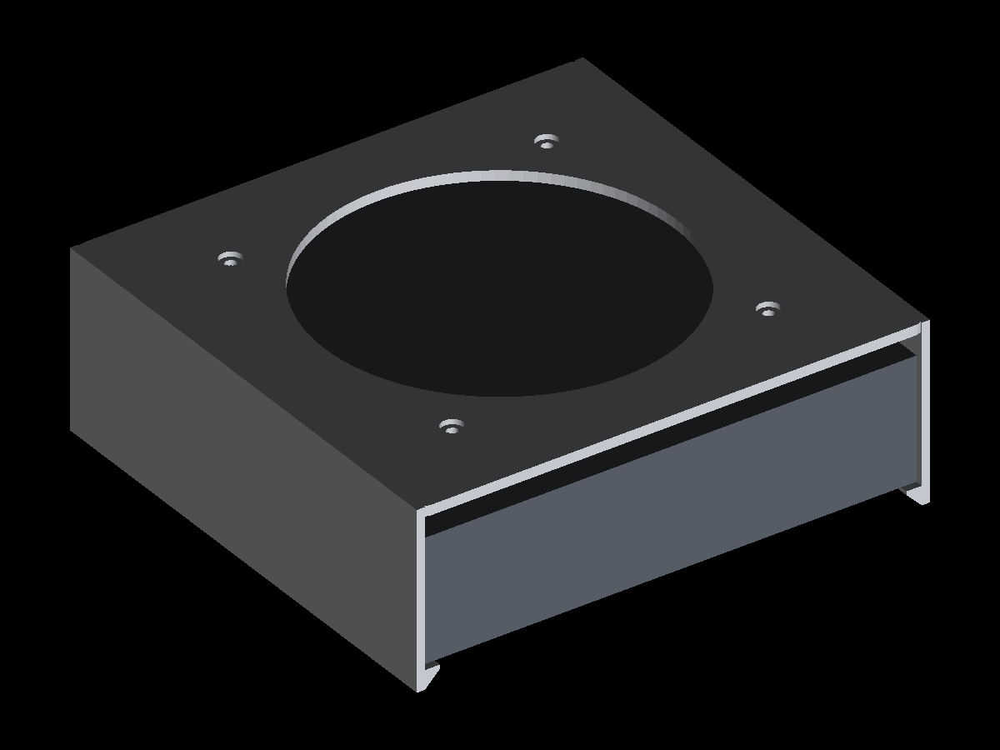
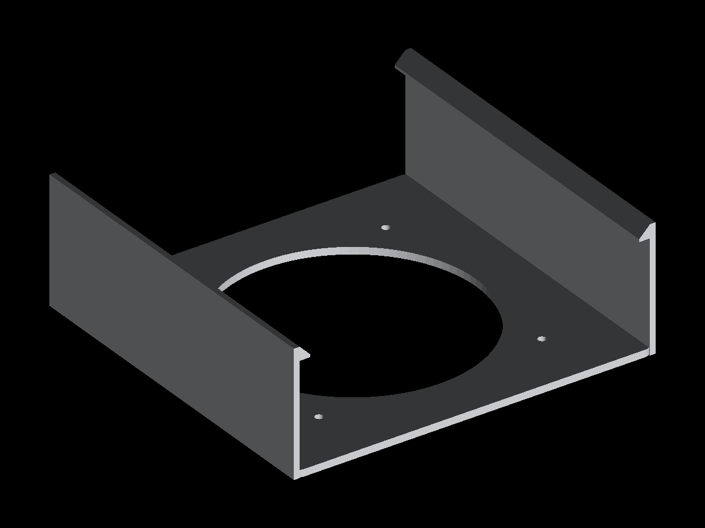

# MS-01 / MS-A1 夹式风扇支架（clip-on fan bracket）

给铭凡 MS-01 / MS-A1 加一把 12cm 或 14cm 风扇，**不换壳、不打孔、不拆机**：
整体像个「盖子」，从前面滑进去夹住机身，风扇装在顶板外侧往机器里吹。

| 视角 | 图 |
|---|---|
| 立体（使用姿态，深色块为机器占位） |  |
| 剖面（看得清倒钩与 10mm 静压腔） |  |
| 打印姿态 |  |

## 结构

```
        风扇（外置，朝下吹）
   ┌───────────────────┐
   │  顶板 202×195×4    │  ← 中间开风扇孔，四角风扇螺丝孔
   │    10mm 静压腔      │  ← 风从这里散开，避免把顶面封死
   │  机身 196×189×48   │
   └───────────────────┘
    两侧竖壁 3.2mm，下探到机身底部
    末端 6mm 内折倒钩，顶面贴住机身底面
    45° 斜面便于滑入/压入
```

- **夹持方式**：两侧壁内宽比机身小 **0.4mm**（每侧 0.2），靠 PETG 弹性夹住；从前/后水平滑入，倒钩兜住机身底面，整件不会掉。
- **静压腔**：顶板比机身顶面高 10mm，风从风扇孔进来后横向铺开，不会在顶面正中形成死角。
- **可逆**：把风扇翻个面装，就从「往里吹」变成「往外抽」，对付顶部排风的机型。

## 文件

| 文件 | 说明 |
|---|---|
| `fan-clip-140.stl` | 单件上夹，14cm（孔距 124.5mm） |
| `fan-clip-120.stl` | 单件上夹，12cm（孔距 105mm） |
| `fan-clip-140-grip.stl` | 上夹加固版：8mm 倒钩 + 后端止挡 |
| `fan-clip-120-grip.stl` | 同上，12cm |
| `fan-hat-140.stl` | 帽子式（无倒钩，直接坐在机器顶面） |
| `fan-hat-120.stl` | 同上，12cm |
| `fan-clip-140-stack.stl` | **上下双风扇**用的上夹（竖壁更长，勾住托盘） |
| `fan-clip-120-stack.stl` | 同上，12cm |
| `fan-tray-140.stl` | **下风扇托盘**，14cm |
| `fan-tray-120.stl` | 同上，12cm |
| `generate.py` | 参数化生成脚本（尺寸/过盈量/模式可改） |
| `render.py` | 无依赖预览渲染器（正交 + z-buffer） |
| `preview_use.py` / `preview_stack.py` | 生成使用姿态与叠装剖面图 |

## 上下双风扇（stack 模式）

上吹 CPU/显卡、下吹 SSD/U.2，两把风扇同时用：


```
  风扇（上，往下吹）        z 74..99
  顶板 4mm                  z 70..74
  静压腔 10mm               z 60..70
  机身（含 718278 → 56mm）   z 4..60     ← 整面坐在托盘顶板上
  托盘顶板 4mm              z 0..4      ← 上夹倒钩勾住它
  箱壁 30mm（当脚）          z -30..0    ← 内缩 10mm 给倒钩让位
  风扇（下，往上吹）         z -25..0    ← 离地 5mm
```

- 托盘（`fan-tray-*.stl`）：**顶板整面承托机身**（不再是 4 根柱子悬空），下挂风扇；四周箱壁内缩 10mm 兼作四只 30mm 高的脚，风扇离地 5mm 才能进风；
- 上夹（`*-stack.stl`）：竖壁伸到托盘底面，倒钩勾住托盘顶板 → 上下锁成一体，可整体搬动；
- 总高 ≈ **129mm**（含 30mm 脚与上方 25mm 风扇）。

```bash
python generate.py --fan 140 --h 56 --mode stack   # 生成上夹 + 托盘
```

⚠️ 上夹要用 **`--h 56`**（装了 718278 加高底盖后的机身高度）生成，否则夹不紧；没装 718278 就用 48。


## 打印

| 项 | 值 |
|---|---|
| 外廓 | 202 × 195 × 69.5 mm（P1/X1 的 256³ 能一次打完） |
| 材料 | **PETG**（要弹性夹持；PLA 也行但脆、别用 TPU） |
| 墙 / 填充 | 3 层墙、15% gyroid（受力的是薄壁，别用 100% 实心） |
| 摆放 | 顶板贴床，竖壁向上（STL 已是这个姿态） |
| 支撑 | 倒钩下沿 45°，**免支撑** |
| 耗材量 | 实体体积 ≈190 cm³；15% 填充实际约 70–90 g |

## 装机

1. 先把四个风扇螺丝从顶板外侧穿入，拧进风扇（M4×20 自攻，或 M4 螺栓 + 螺母）；
2. 风扇线从侧面引出；
3. 把整件**从机器前面水平滑入**（倒钩会兜住底面），推到底；
4. 如果偏紧：先用 `--clear 0.4` 重新生成；偏松就 `--clear -0.4`。

## 改尺寸

MS-A1 与 MS-01 尺寸接近但不必完全相同，先量三围再生成：

```bash
python generate.py --fan 140 --w 196 --d 189 --h 48 --clear -0.2
```

| 参数 | 含义 |
|---|---|
| `--fan 120/140` | 风扇规格（决定孔径与孔距） |
| `--w/--d/--h` | 机身宽/深/高（mm） |
| `--clear` | 每侧过盈量，负值=夹紧；默认 `-0.2` |

## 三种装法（按「会不会滑」选）

| 模式 | 怎么装 | 竖直防滑 | 水平防滑 | 适合 |
|---|---|---|---|---|
| `top` | 抬起机器，从前面推入 | ✅ 倒钩正止挡 | ❌ 无 | 只当盖子，不搬动 |
| `grip` | 抬起机器，从前面推入到底 | ✅ 8mm 倒钩 | ✅ 后端止挡 | 固定摆放、怕被线拉走 |
| `hat` | 直接扣在顶面 | ✅ 坐在机器上（靠重力） | ⚠️ 只有 0.5mm 裙边定位 | 随时拿走、零安装 |
| `stack` | 托盘在下、机器放上、上夹扣上 | ✅ 倒钩勾托盘 | ✅ 四周被托盘限位 | 上下双风扇 |

**为什么 `top/grip` 不会往下滑**：倒钩的接触面在机身底面以下，是**正向止挡**而不是摩擦——机器越重，倒钩压得越实。前提是机身底边是直角；如果底边是大圆角，倒钩只有 8mm 接触，会被挤开，这种情况改用 `hat` 或 `stack`。

**已知不便**：`top/grip` 的倒钩在机器底下，安装时**必须先把机器抬起来**再套，不能直接在桌面上推；`hat` 没有这个问题。

## 与 MakerWorld 718278 加高底盖的搭配

718278 是「底盖和机身之间塞垫块」，装好后：

- 机身总高 **48 → 约 56mm**，上夹必须 `--h 56`；
- 倒钩勾住的是**加高底盖的底边**，不再是最初的机身底面；
- ⚠️ 唯一要实测的：垫块/底盖的外沿有没有比机身宽。如果宽出 2mm 以上，夹子的内宽就对不上，需要把 `--w/--d` 按加高后的实际外形重新给；
- 叠装时托盘放在加高底盖下面，4 根柱子顶住底盖，受力没问题。

## 已知取舍

- 顶板覆盖了机器顶面（除风扇孔），如果机型顶部是**排风**，建议把风扇反装成抽风，或改用 12cm 版减少遮挡；
- 没有做走线槽，风扇线走前/后开口；
- 夹持力靠 0.4mm 过盈，机身若有橡胶包边/脚垫顶住倒钩，需要把 `--h` 加上脚垫厚度。
- **MS-01 装了 718278 加高底盖后整机高 ≈56mm**，夹子要按 56 生成，否则倒钩兜不到底：
  `python generate.py --fan 140 --h 56`。更稳的做法是拿卡尺量装好后的实际高度。
