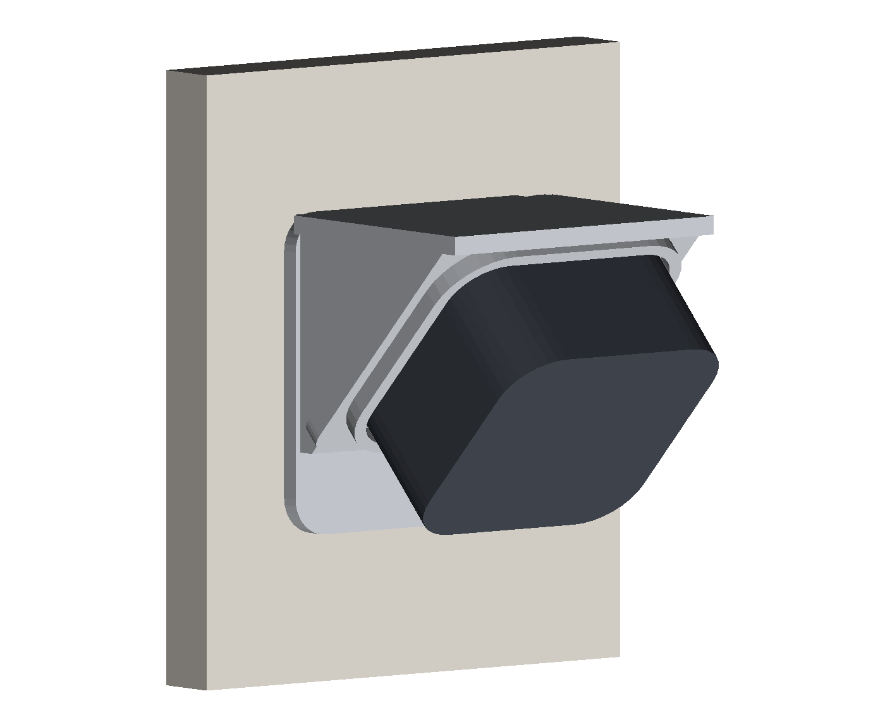
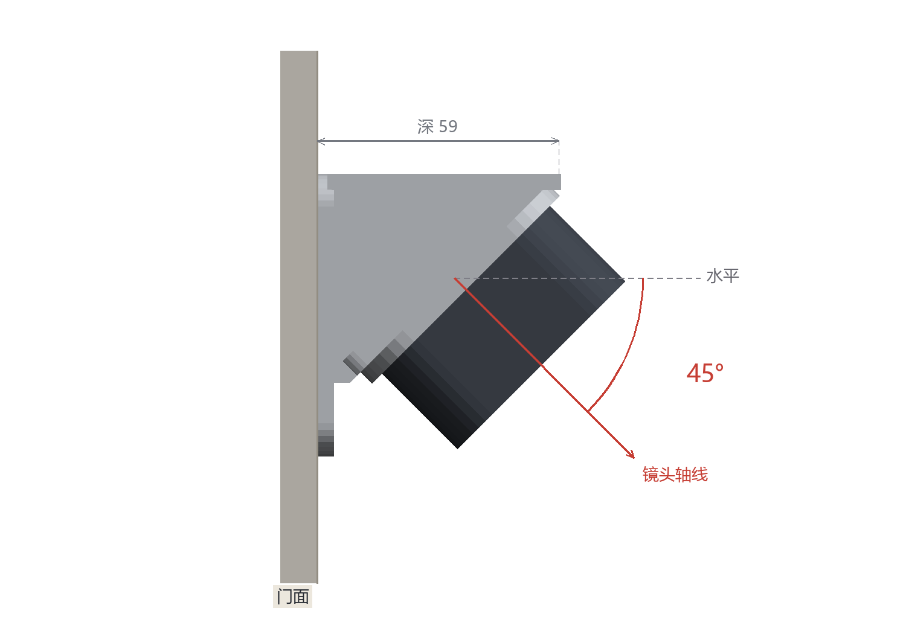
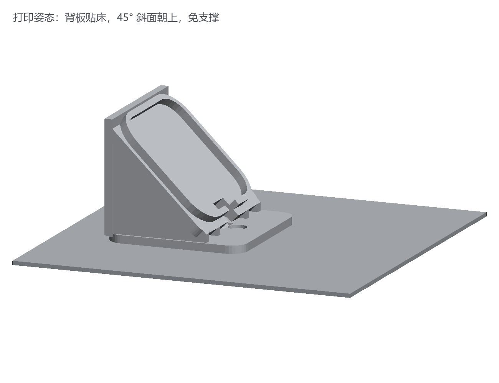
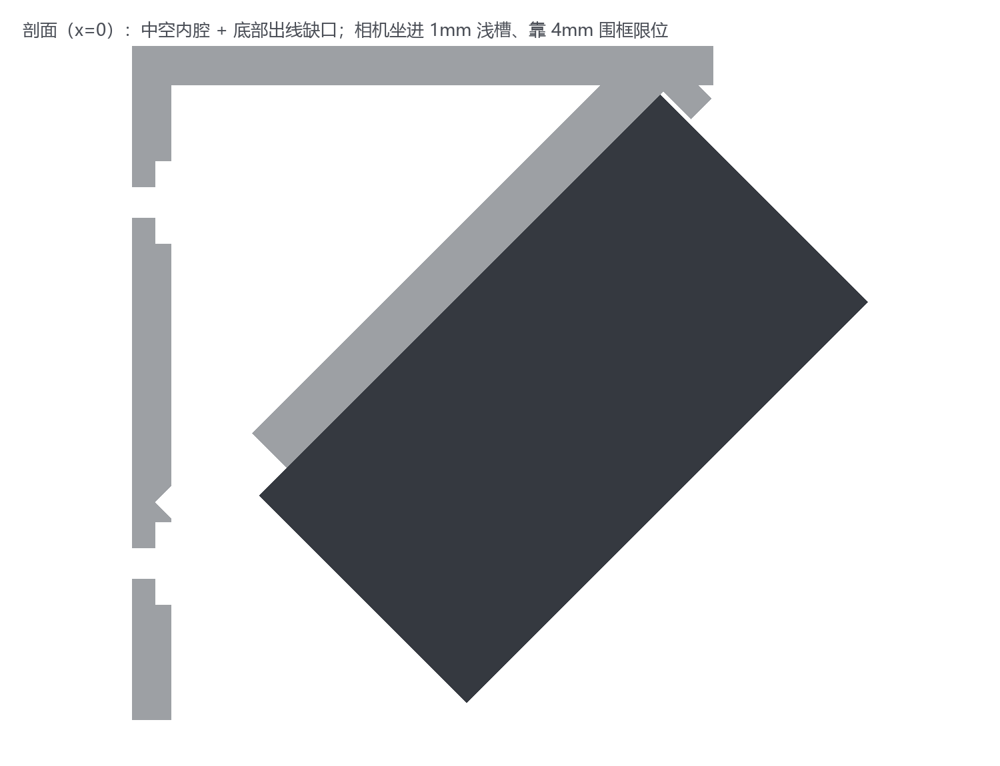

# Zmodo 4MP 窗户摄像机 · 45° 门挂转接板

把 Zmodo 4MP 窗户摄像机（官方标 2.28 × 2.28 × 1.18 inch ≈ 58 × 58 × 30 mm）从
「背面贴玻璃、镜头水平朝外」改成**贴在门上、镜头斜向下 45°** 的转接板。

一件、免支撑、PETG 约 60 g。相机**不用胶死在架子上**：架子有个 4mm 高的围框，
相机落进 1mm 浅槽里，靠围框限位 + 一片 3M 胶带防脱，想拆（换角度 / 收起来）直接拔出来。

| 使用姿态 | 侧视（45° 是怎么来的） |
|---|---|
|  |  |
| **打印姿态** | **剖面** |
|  |  |

---

## 为什么是这个形状（别「优化」掉）

摄像机的**镜头朝向 = 它背面贴的那个面的外法线**。想让镜头朝下 45°，装它的面就
必须朝下 45° —— 于是相机是**吊在楔形件下面**的，楔形件在它上面/后面：

```
   门 │╲
      │ ╲ ← 45° 装夹面（法线 = 门外 + 斜下）
      │  ╲
      │   ╲  相机（30mm 厚，从这个面斜着伸出去）
      └────╲
```

反过来的那种「楔形块在下面、相机坐在斜面上」看着更像转接器，但那样镜头是**朝上**的
（法线朝上外）。这不是偷懒，是「背面平贴的相机 + 刚性 45°」唯一可能的拓扑。

---

## 关键尺寸

| 项 | 值 |
|---|---|
| 整体（安装姿态） | **70 宽 × 59.4 深 × 68.9 高** mm |
| 离门最远点 | 59.4 mm（顶板前缘）；装好相机后镜头端离门约 **75 mm** |
| 相机槽 | 58.8 × 58.8，圆角 **R11**，深 **1.0 mm**（相机 58×58/R12，单边 0.4 间隙） |
| 围框 | 宽 3 mm、高 **4 mm**（挡住相机下沿，防止往下滑） |
| 45° 主板 | 5 mm 厚 |
| 贴门背板 | 4 mm 厚，圆角 R8；贴胶区 **60 × 48**；两个 Ø4.3 通孔（内侧 Ø9 沉孔）可选 |
| 出线缺口 | 12 mm 宽，开在围框下沿正中，切穿主板下沿 → 线从腔体底部出来 |
| 加强 | 2 片侧筋 3.5 mm + 2 片内肋 3 mm，都从背板一直搭到 45° 主板 |
| 体积 | 71.0 cm³（实心）；PETG 实心约 90 g，3 墙 + 25% 填充约 **55–65 g** |

角度按**相对水平面**算：门是竖直的，所以镜头轴线 = 水平向下 45°。

---

## 文件

| 文件 | 说明 |
|---|---|
| `zmodo-45-door-mount.stl` | **打印件**（已是打印姿态：背板贴床） |
| `zmodo-camera-mock.stl` | 相机占位体，**只是量具**，用来试配合；5% 填充打印即可 |
| `generate.py` | 参数化生成（角度 / 相机尺寸 / 间隙 / 宽度 / 斜面长度） |
| `render.py` | 无依赖预览渲染器（正交 + z-buffer） |
| `preview.py` | 出上面这几张图 |
| `preview-*.png` | 预览图 |

```powershell
python generate.py                     # 45°、标称尺寸，覆盖两个 STL
python generate.py --angle 30          # 想要 30° 俯角
python generate.py --cam-w 58 --cam-h 58 --cam-r 14 --clear 0.5
```

脚本每次都会报：相机干涉体积（应为 0）、水密性、体积、最平朝下面的角度（≥45° 才免支撑）。

---

## 打印

| 项 | 值 |
|---|---|
| 材料 | **PETG**（推荐，耐晒、韧）；PLA 也能用，别用 TPU |
| 摆放 | **按导出的姿态放**：背板贴床、45° 斜面朝上 |
| 墙 / 填充 | 3 墙、25% gyroid；5 mm 主板和围框是受力件，别用 10% 以下 |
| 支撑 | **不需要**。全件需要支撑的面积只有 25 mm²（筋底 4 mm 小桥 + 顶角几平方毫米），切片器直接过 |
| 高度 / 时间 | 59.4 mm 高，0.2 mm 层高约 2–3 小时 |
| 外廓 | 70 × 68.9 mm 底面，任何 180×180 的热床都放得下 |

> 建议先打 `zmodo-camera-mock.stl`（2 墙 5% 填充，几分钟）塞进槽里试一下松紧，
> 再打本体。偏紧就 `--clear 0.5` 重出，偏松就 `--clear 0.3`。

---

## 装

1. **先比划位置**。这块东西从门面凸出 59 mm，装上相机后镜头端离门约 **75 mm**。门开合时
   会不会扫到门框、柜门、墙？装在**门的中间偏铰链侧**最稳，别贴着合页边（一转就撞）。
2. 门面擦干净（酒精），把 3M VHB / 泡棉双面胶（≥ 0.8 mm 厚）裁成 **60 × 48**，
   贴在背板中央，压实后**静置 24 小时**再挂相机（胶的强度是随时间起来的）。
   不想用胶就从腔体底部伸进去拧两颗自攻螺丝（Ø4.3 孔，内侧有沉孔）。
3. 相机线从**腔体底部**穿出去，沿门往下走；缺口在围框下沿正中，线不会压在相机底下。
4. 相机背面贴一片 3M 胶（或者把你原来那个磁吸底座/铁片直接贴进槽里，磁吸款更好拆），
   对准围框**放进去**，压平。相机下沿落在围框上 —— 重量压在架子上，胶只负责「别掉出来」。
5. 转一下相机确认镜头是**斜着向下**的：门竖直时，镜头轴线与水平面成 45°。

**注意**：这个架子的 45° 是相对「门面竖直」定义的。门要是斜的（老房子很常见），
实际俯角会跟着变 —— 要么按实测角度 `--angle` 重出，要么接受偏差。

---

## 改尺寸

| 参数 | 含义 | 什么时候改 |
|---|---|---|
| `--angle` | 俯角（相对水平），默认 45 | 想要 30° / 60° |
| `--cam-w/--cam-h` | 相机宽/高（mm），默认 58 | 拿卡尺实测，或换别的相机 |
| `--cam-r` | 相机正面圆角，默认 12 | **一定要量**：槽的圆角 = cam_r−1，量大了会顶角 |
| `--clear` | 单边配合间隙，默认 0.4 | 打印机偏大/偏小 |
| `--width` | 整体宽度，默认 70 | 相机更大时 |
| `--face-len` | 45° 斜面长度，默认 72 | 改 `--cam-*` 后不够放就加大 |

改 `--angle` 会同时改变外形（30° 更高更薄，60° 更矮更厚），脚本会打印新的
高/深/相机下沉量，照着核对门上的位置。

---

## 踩过的坑（v1 → 现在这版）

都是做这版时真踩出来的，改参数前先看：

1. **出线缺口会把贴门背板打穿。** 缺口是沿 45° 面的法线切的，而斜面下沿离门面越近，
   背板就越薄地贴在后面。`Y0 = 4` 时缺口一路切穿 4 mm 背板，**在胶带面上开了个 12×4 的洞**。
   → 斜面下沿必须离门面 ≥ 8 mm（`Y0`），缺口只会在背板上刮出不到 1 mm 的浅槽。
2. **三角筋没搭到背板。** 筋的底边一开始从斜面下沿开始，结果整块斜面的连接只剩顶板一条，
   等于悬臂。→ 筋的底边必须伸到 `BACK_T-0.5`（插进背板 0.5 mm，顺带避免共面薄壁）。
3. **顶板离背板 3.5 mm 悬空。** 顶板后沿误用了 `y0`，STL 顶部真的有一条缝。→ 后沿用 `BACK_T-0.5`。
4. **槽的圆角必须比相机圆角小。** 同样边长下圆角越大，对角方向越「往里收」，
   相机四个角会顶到槽角（实测干涉 35 mm³）→ 槽用 `cam_r-1`。
5. **共面布尔会留内壁。** 筋顶/筋背如果和顶板、背板严格共面，union 后 STL 里会剩内部面
   （水密但多余）。→ 筋故意超出 2 mm，最后统一切平。

---

## 已知取舍

- 相机是**吊装**在斜面下的（见开头），侧面看会「藏」在架子下面；这是 45° 下俯的必然结果。
- 只按**背面平整**建模。如果相机背面是弧面、磁吸底座凸出一圈，先量凸出量告诉我，
  槽深/槽形要改。
- 线缺口在**正下方**。相机线从侧边/背面正中的话，缺口位置要挪。
- 没做防水。室内门、或者门上有雨棚没问题；露天淋雨建议整块喷一层或换 ASA。
- 70 mm 宽是给 58 mm 相机留 6 mm 边。相机更大时 `--width` 要一起加。
