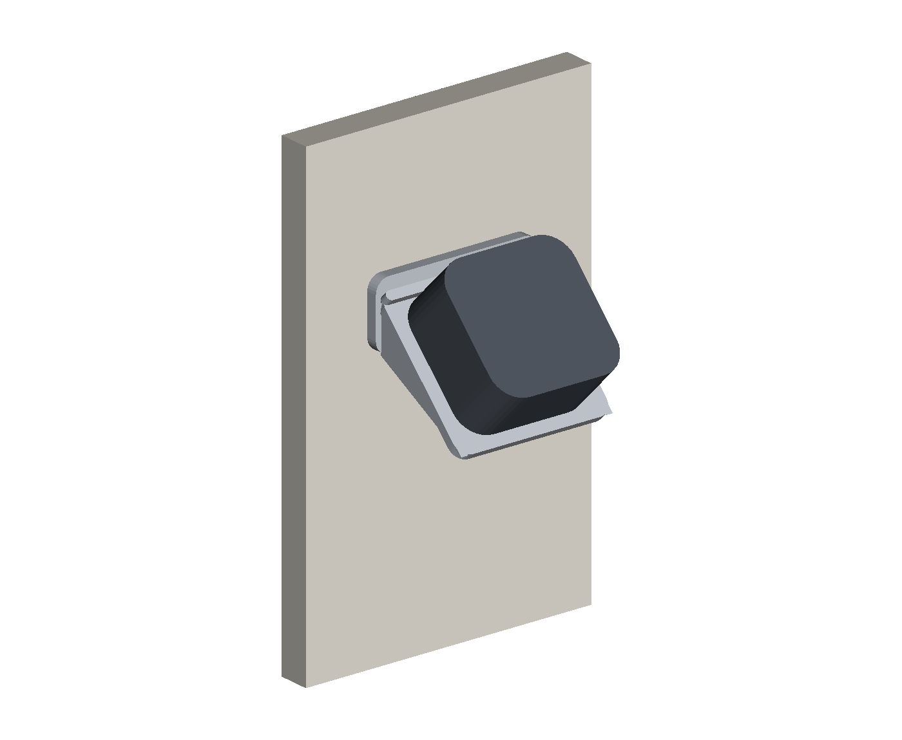
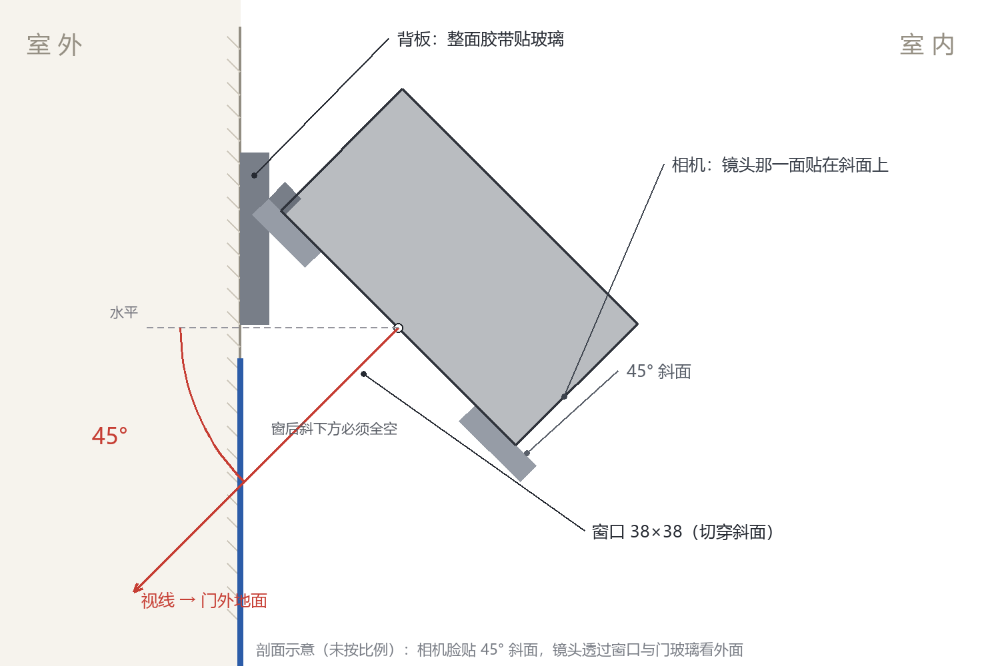

# Zmodo 窗户摄像机 · 45° 过窗俯视支架（v2）

**这一版推翻了 v1 的拓扑。** 这台相机的贴胶面**就是镜头面**：胶贴在镜头那一面，
镜头隔着玻璃往外拍。所以真正要满足的不是「相机吊在楔形件下面」，而是：

> 相机要**透过**它贴着的那块面看出去。

于是楔形件必须在**下面**、相机坐在 45° 斜面上，斜面正中开窗口，窗后全是空的：

| 使用姿态 | 原理剖面 |
|---|---|
|  |  |
| **打印姿态** | |
|  | |

> v1（`../45deg-door-mount/`）按「相机吊在斜面下」做的，方向是反的，**别打那个**。
> 留着只是为了记录走过的那条弯路。

---

## 它解决什么

Zmodo 4MP 窗户摄像机（2.28 × 2.28 × 1.18 inch ≈ 58 × 58 × 30 mm）本来是**贴平玻璃、
水平朝外**。装在门的室内侧、又想拍到门外**门口地面**，就得让镜头轴线往下压 45°。

但镜头必须正对着玻璃才有视野 —— 所以相机不能直接贴平，得先贴在一块 45° 的板上，
板上给镜头留窗口，窗后到玻璃之间**不能有任何东西**（包括支架自己的背板和筋）：

```
   门 │█╲                     ← 背板（胶贴玻璃）
      │█ ╲
      │█  ╲  ← 45° 斜面，相机脸贴在这上面
      │█   ╲
      │     ╲   ← 这一段必须全空：视线从窗口穿到玻璃
      └──────╲
```

---

## 关键尺寸

| 项 | 值 |
|---|---|
| 外形（安装姿态） | **74 宽 × 51.7 深 × 57.5 高** mm（z 20.5…78） |
| 45° 斜面 | 70 × 66，厚 4 mm；与水平面成 45° |
| 镜头窗口 | **38 × 38，圆角 R10**，切穿斜面；相机 58 见方 → 四周留 **10 mm** 贴胶边 |
| 上沿挡边 | 凸出斜面 4 mm（相机往下滑时顶住它，别指望胶兜住重量） |
| 贴门背板 | 74 × 30 × 5 mm，整面贴胶（贴玻璃）；**刻意很小**——它再往下伸就会挡住视线 |
| 两侧三角筋 | 3 mm，从背板撑到斜面下沿，压在 x=±33（挡不到中央视锥） |
| 体积 | 26.2 cm³ 实心 → PETG 实心约 33 g，3 墙 25% 填充约 **22–26 g** |
| 视锥要求 | 轴线在门面上的落点：背板下沿往下约 28 mm；需要透明区域约 **95 宽 × 96 高**，即**背板下沿再往下 105 mm 内都得是玻璃** |

角度按相对水平算：门竖直 → 镜头轴线 = 水平向下 45°。

---

## 文件

| 文件 | 说明 |
|---|---|
| `zmodo-45-window-shelf.stl` | **打印件**（已是打印姿态） |
| `zmodo-camera-mock.stl` | 相机占位体，试配合用，5% 填充打 |
| `generate.py` | 参数化生成 + 三项自检（干涉 / **视线射线** / 支撑面积） |
| `render.py` | 无依赖预览渲染器 |
| `preview.py` | 出图（含那张 2D 原理剖面） |
| `preview-*.png` | 预览图 |

```powershell
python generate.py                       # 45°，标称尺寸
python generate.py --angle 40            # 换个俯角
python generate.py --win 42              # 窗口更大（贴胶边变窄）
python generate.py --cam-w 58 --cam-r 14 # 相机实测尺寸
```

每次生成都会打印：镜头中心、**视线在门面上的落点**、需要的透明区域、相机干涉
（应为 0）、**9 条视锥射线是否被支架挡住**（应为 0）、需支撑面积。

---

## 打印

| 项 | 值 |
|---|---|
| 材料 | PETG（推荐）；PLA 也行，别用 TPU |
| 摆放 | **按导出姿态放**：贴门背板（胶面）朝下贴床，斜面 45° 抬起 |
| 墙 / 填充 | 3 墙、25% gyroid |
| 支撑 | **不需要**（需支撑面积 4 mm²） |
| 底板 | 74 × 30 mm 只占一角，重心离底面前沿约 5 mm —— **建议开 5 mm brim** |
| 体积 / 时间 | 26 cm³，约 1–1.5 小时 |

先打 `zmodo-camera-mock.stl`（几分钟）比一下相机，再打本体。

---

## 装

1. **确认玻璃位置。** 背板贴在玻璃上，而镜头要从背板**下方**看出去：
   背板下沿往下 105 mm、左右各 47 mm 的范围都得是玻璃。装之前拿卷尺比一下。
2. 玻璃内侧擦干净（酒精），3M VHB 裁 74 × 30 贴在背板背面，压实，**静置 24 h**。
   玻璃上贴胶别贴太满——背板本身就小，透气一点反而好贴。
3. 相机**镜头那一面**贴一片 3M 胶（或用它自带的胶），对准窗口放上去，
   往上推到底（顶住上沿挡边）。相机往下滑是靠这个挡边兜住的，胶只负责不脱离。
4. 门关上、室内关灯，看一眼实时画面确认正对着门外地面。

---

## 这个方案绕不过去的物理限制（先知道再装）

1. **画面四角会被门/窗框切掉。** 45° 斜着看窗，越靠画面边缘的视线越接近贴着玻璃走，
   需要的玻璃面积迅速变大（四角射线的落点在几百毫米外）。中间那块门口地面不受影响，
   这是「斜看窗户」的透视窗效应，换任何支架都一样。
2. **晚上室内开灯会反光。** 贴平玻璃时镜头几乎贴着玻璃，没空气层；斜了就隔着一段空气，
   玻璃变成半面镜子。夜里室内比室外亮时，画面会叠一层室内倒影 —— 需要就把这块玻璃
   附近遮光，或者干脆夜里别开那盏灯。
3. **只能装在玻璃上。** 门没有玻璃的话，这个思路不成立（镜头会看到门板）。

---

## 参数

| 参数 | 含义 | 备注 |
|---|---|---|
| `--angle` | 俯角，默认 45 | 改小（30）→ 更矮、更靠上；改大（60）→ 更陡、更深 |
| `--cam-w/--cam-h` | 相机正面尺寸，默认 58 | 卡尺实测 |
| `--cam-r` | 相机正面圆角，默认 12 | 影响相机占位体，不影响支架（支架不夹相机） |
| `--win` | 窗口边长，默认 38 | 相机 58 → 每边贴胶边 = (58−win)/2；别小于 34 |
| `--plate-l` | 斜面长度，默认 66 | 相机 58 + 两侧余量 |

⚠️ 改 `--angle` 会同时改变「需要的透明区域」：角度越大，视线越陡，玻璃要往下延伸得越多。
生成时会打印新的落点，照着核对。

---

## 做这版时踩的 / 想清楚的

1. **v1 的拓扑从根上错了**：我以为贴胶面是背面，实际是镜头面。判断依据只有一条 ——
   「镜头朝向 = 它背后那个面的法线」和「镜头朝向 = 它贴着那个面的外法线」是相反的，
   用错一条，整个楔形就该翻过来。
2. **窗口不能小。** 相机脸贴在斜面上，镜头在板厚 4 mm 的窗口里往外看；窗口每边留
   19 mm 才够视锥在板厚内偏出去（4 mm 厚、50° 半角 → 只需 ~5 mm 的偏移，余量很大）。
3. **筋必须躲开视锥，但不必躲全部视锥。** 筋在 x=±33，中央视线从 x≈0 穿过；
   水平 ±50° 的射线在到达 x=33 之前就已经出了门面，所以碰不到筋。每次生成都会
   用 9 条射线实测这件事（`_ray_hits`，Möller–Trumbore，不依赖 rtree）。
4. **背板不能再往下伸。** 背板下沿每往下一毫米，挡住的就是画面正下方 —— 门口地面。
   所以背板只有 30 mm 高，剩下的刚度交给两侧三角筋。
5. **打印会往前倾。** 斜面朝上、胶面贴床，重心在底面前沿外 5 mm 内，开 brim 就稳。

---

## 已知取舍

- 相机**不夹紧**，靠「重力压进斜面 + 上沿挡边顶住 + 一片胶」，取下换位置很方便；
  想要更保险可以再在两角加扎带孔（说一声我加）。
- 没做防水，纯室内件。
- 相机的线从机身出来，完全外露 —— 这个形态不需要走线槽。
- 若你的门玻璃只有窄窄一条（< 95 × 96），窗口对不上，得改成「把支架尽量贴高、玻璃下沿对齐」，
  或者换角度（角度小一点，需要的玻璃就矮一点）。
