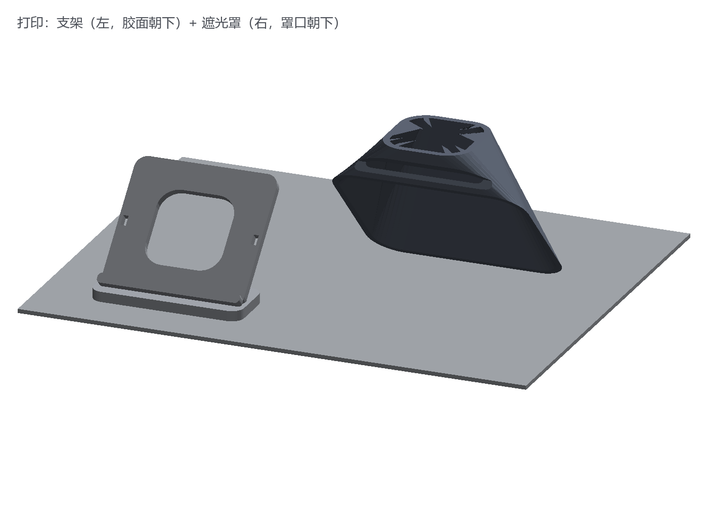

# Zmodo 窗户摄像机 · 45° 过窗俯视支架 + 遮光罩

给这台相机（2.28 × 2.28 × 1.18 inch ≈ **58 × 58 × 30 mm**，**贴胶面 = 镜头面**）做的
一套两件：

| 件 | 干什么 |
|---|---|
| **支架** `zmodo-45-window-shelf.stl` | 贴在门玻璃内侧，把相机架到 45° 俯角；上沿挡边 + 两侧扎带孔兜住相机 |
| **遮光罩** `zmodo-light-hood.stl` | 把「窗口 → 玻璃」这段视线整段包成一条暗通道，**室内光进不到那块玻璃上，就没有室内反光** |

| 使用姿态 | 原理剖面 |
|---|---|
|  |  |
| **打印（两件）** | |
|  | |

> 更早两版：`../45deg-door-mount/` 拓扑是反的（别打）；本目录的 v2（只有支架、没有罩子）
> 仍然可用（`git log` 里能找到），但晚上室内开灯会看到反光。

---

## 三个约束凑成了这个形状

1. **镜头要“透过去”看**：贴胶面就是镜头面 → 支架必须是「斜面板 + 正中窗口」，
   窗口背后到玻璃之间不能有东西。
2. **45° 斜看玻璃必反光**：镜头离玻璃 40mm 左右，玻璃内表面把室内光镜像进镜头。
   只有把这段空气**包起来、并且罩口压住玻璃**（泡沫胶条），才能把室内光挡在外面。
3. **罩子必须够大**：视锥 ±46°×±26°，在门面上的落点摊开成 **90 × 80**，
   所以罩子是「小口接窗口、大口压玻璃」的喇叭——小口 44×44，大口 90×80。

```
   门 │█╲                          ← 背板（整面胶带贴玻璃）
      │█ ╲  ← 45° 斜面，相机脸贴这儿
      │█  ╲
      │█   ╲┌────────────────┐
      │     │  遮光罩（黑色）  │      ← 视线被这条暗通道包住，室内光进不来
      │     └────────────────┘
      └──── 罩口 90×80：泡沫胶条压住玻璃
```

---

## 关键尺寸

| 项 | 值 |
|---|---|
| 支架外形 | **74 宽 × 51.7 深 × 57.5 高** mm（z 20.5…78） |
| 45° 斜面 | 70 × 66 × 4，正中 **38×38 R10** 窗口，四周留 10 mm 贴胶边 |
| 相机限位 | 上沿挡边 **5 mm 高**（相机沿斜面下滑的分量全压在它上面）+ 两侧 **2.6 × 5 mm 扎带孔**（备用，扎带从相机背面兜一道） |
| 贴门背板 | 74 × 30 × 5，整面 3M 胶带贴玻璃；它再往下伸就会挡住画面正下方，所以只有 30 高 |
| 遮光罩 | 小口 44×44（贴斜面背面）、大口 **90 × 80**（口在门面上，z −39…40），壁厚 3 mm，罩口 3 mm 宽的平面用来压泡沫胶条 |
| 罩口位置 | 背板下沿（z 48）往下 4…91 mm 就是罩口 / 玻璃要露出的范围 |
| 体积 | 支架 25.0 cm³（PETG 实心 32 g）、罩子 25.7 cm³（33 g）；3 墙 25% 填充合计约 **45–50 g** |

角度按相对水平算：门竖直 → 镜头轴线 = 水平向下 45°。

---

## 文件

| 文件 | 说明 |
|---|---|
| `zmodo-45-window-shelf.stl` | **支架**（打印姿态：胶面朝下贴床） |
| `zmodo-light-hood.stl` | **遮光罩**（打印姿态：罩口朝下贴床） |
| `zmodo-camera-mock.stl` | 相机占位体，试配合用，5% 填充打 |
| `generate.py` | 参数化生成 + 自检（干涉 / 视线射线 / 支撑面积 / 两件是否互插） |
| `render.py` / `preview.py` | 无依赖渲染器 + 出图（含 2D 原理剖面） |
| `preview-*.png` | 预览图 |

```powershell
python generate.py                    # 45°，标称尺寸，一次出三个 STL
python generate.py --angle 40         # 换俯角（罩口会跟着重算）
python generate.py --win 42           # 窗口更大（贴胶边变窄）
```

每次都会打印：镜头中心、需要的透明区域、**罩口尺寸与位置**、相机干涉（应为 0）、
**9 条视锥射线是否被挡**（支架 0 条；罩子只有四角被罩壁切掉——见下）、
支架与罩子是否互插（应为 0）、两件各自的支撑面积。

---

## 打印

| 项 | 支架 | 遮光罩 |
|---|---|---|
| 材料 | PETG / PLA 都行 | **黑色 PETG 最好**（内壁吸光，白色会返光） |
| 摆放 | 胶面朝下贴床 | **罩口朝下**贴床 |
| 墙 / 填充 | 3 墙 25% | 3 墙 25%（壁就是 3 mm，别用 0.8 的线宽去糊它） |
| 支撑 | 不需要（44°） | 不需要：唯一水平的朝下面只有窗口那圈 3 mm 宽的环，两边都有墙托着，等于桥接 |
| 用量 / 时间 | 32 g 实心 → 约 1.5 h | 33 g 实心 → 约 2 h |
| 底板 | 74×30 占一角，重心离前沿 5 mm → **开 5 mm brim** | 罩口 90×80，很稳，不用 brim |

---

## 装

1. **先把罩子粘到支架上。** 罩子小口那端（44×44 的 3 mm 宽环面）对着斜面**背面**、
   套在 38×38 窗口外圈，用 CA 胶 / 环氧 / 硅酮沿一圈粘死，**别漏缝**——
   这条缝漏光，罩子就白做了。粘完等固化。
2. **比划玻璃位置。** 罩口是 90 × 80，压在玻璃上；背板下沿往下 4…91 mm、左右各 45 mm
   都得是玻璃。装之前拿卷尺对一下。
3. 玻璃内侧擦干净（酒精）；背板背面贴 3M VHB（74 × 30），罩口那一圈贴**泡沫胶条**
   （3–5 mm 宽、2–3 mm 厚，黑色最好），压实，**静置 24 h**。
4. 相机**镜头那一面**贴一片 3M 胶，对准窗口放上去，往上推到底顶住挡边。
   想更保险就从两侧扎带孔穿一根扎带，兜过相机背面（不挡镜头）。
5. 关门、室内关灯，看实时画面确认：正对门外地面，画面里没有室内倒影。

---

## 会说清楚的三件事

1. **画面四角会被罩壁切掉。** 45° 斜看时，越靠画面边缘的视线越贴着玻璃走，
   需要的罩口迅速变大（四角射线落点在几百毫米外），90×80 的罩口盖不住，
   四角就是罩壁（暗的）。中间那块门口地面不受影响 —— 生成脚本每次都会报哪几条被挡。
2. **反光是被“挡”掉的，不是被“消”掉的。** 前提是罩口真的压住玻璃、粘接处不透光。
   泡沫胶条压不实、或者罩子粘得有缝，室内光照样能漏到玻璃上。
3. **只能装在玻璃上。** 门没有玻璃的话这套东西不成立（镜头会看到门板）。

---

## 参数

| 参数 | 含义 | 备注 |
|---|---|---|
| `--angle` | 俯角，默认 45 | 改小 → 视线更平、罩口更矮；改大 → 更陡、罩口更长 |
| `--cam-w/--cam-h` | 相机正面尺寸，默认 58 | 卡尺实测 |
| `--win` | 窗口边长，默认 38 | 相机 58 → 贴胶边 = (58−win)/2；别小于 34 |
| `--plate-l` | 斜面长度，默认 66 | 相机 58 + 余量 |

视锥 ±46°×±26°（`FOV_H/FOV_V`）是**按这类窗户相机估的**：如果你的机器视角更窄，
罩口可以改小（更紧凑）；更宽就要加大，否则四角黑边更明显。拿实际画面看一次最快。

---

## 踩过的坑

1. **v1 拓扑反了**（贴胶面当成了背面）；v2 少了罩子，晚上反光。
2. **罩子小口必须对着窗口、不是把窗口堵上**：小口内圈 37.6，正好让开 38 的窗口，
   镜头视野不被自己挡。
3. **罩子会顶到贴门背板**：背板下沿 48，罩子在 y=5 处已经到 51 → 从罩子上把背板占的
   那块空间切掉（留 2.5 mm 余量），两件才不互插。
4. **放样不能按点的 index 配对**：两个环在不同平面里生成，起始点和方向都不一样，
   硬配会把喇叭拧成蝴蝶结——STL 照样“水密”，体积只有 1/7。按**绕轴角度**排序再配对。
5. **严格共面的布尔会算出薄薄一层“干涉”**（罩子端面 vs 斜面背面）：留 0.15 mm 缝，
   这点缝正好给胶。

---

## 已知取舍

- 罩子内壁是打印面，不光滑；它只负责挡光，越哑光越好（黑色 PETG 或喷哑光黑）。
- 相机靠「重力压进斜面 + 上沿挡边 + 一片胶（+ 可选扎带）」，取下换位置方便。
- 没做防水；纯室内件。
- 罩子大而显眼（90×80 的口），这是 45° 俯角 + 宽视角的代价，想低调可以把
  `--angle` 降到 35 左右，罩口会明显变矮。
